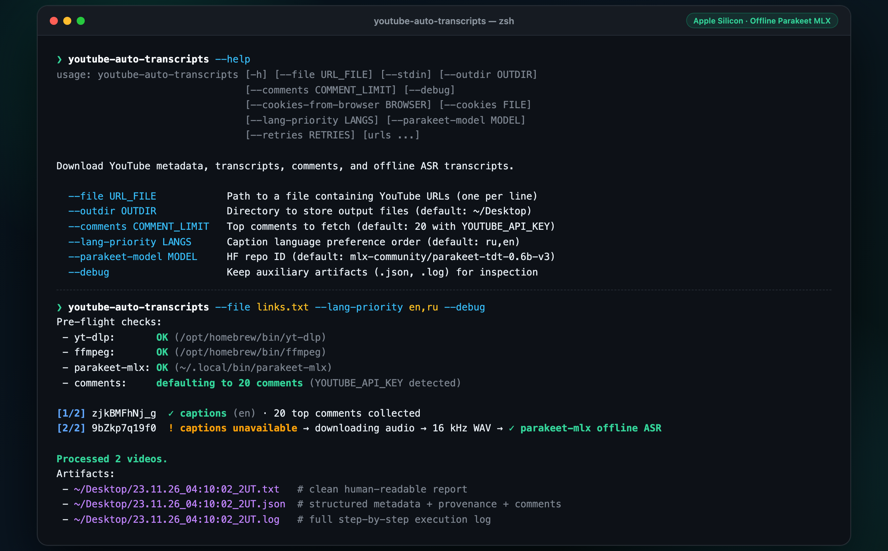

# 🎙️ Youtube Auto Transcripts

<div align="center">

[](https://www.python.org/)
[](#how-it-works)
[](https://huggingface.co/mlx-community/parakeet-tdt-0.6b-v3)
[](LICENSE)

**Local-first Python CLI to extract YouTube metadata, transcripts, and top comments — prefers existing captions and falls back to offline [Parakeet MLX](https://huggingface.co/mlx-community/parakeet-tdt-0.6b-v3) ASR on Apple Silicon.**

[How It Works](#-how-it-works) • [Prerequisites](#-prerequisites) • [Installation](#-installation) • [Usage](#-usage) • [Output Layout](#-output-layout) • [Related Tool](#-looking-for-a-web-ui--channel-filters)

<br>



</div>

---

## ⚙️ How It Works

Each video URL passes through a deterministic, local-first pipeline — zero cloud transcription APIs required:

| Stage | Engine / Tool | Behavior | Output / Fallback |
|---|---|---|---|
| **1. Metadata** | `yt-dlp -J` | Fetches title, channel, upload date, duration, tags, and description without downloading video payloads | Retries up to `--retries` (default `3`); infers `video_id` from URL if metadata fails |
| **2. Captions (Fast Path)** | `youtube-transcript-api` | Pulls existing captions according to `--lang-priority` (default `ru,en`) | Records `source: "captions"` and skips audio download |
| **3. Offline ASR Fallback** | `yt-dlp -f ba` → `ffmpeg` → `parakeet-mlx` | Triggered automatically when captions are missing or disabled — downloads audio-only stream, converts to `16 kHz` mono WAV, transcribes locally with Parakeet MLX | Records `source: "parakeet"`; auto-deletes temp audio unless `--debug` fails |
| **4. Top Comments (Optional)** | YouTube Data API v3 | Fetches top relevant comments when `YOUTUBE_API_KEY` is exported (default `20`, configurable via `--comments`) | Gracefully skipped (`0` comments) if API key is unset |
| **5. Export** | Built-in writer | Writes a clean human-readable `.txt` report by default | Add `--debug` to emit structured `.json` (metadata, transcript provenance, comments) + `.log` |

---

## ✨ Highlights

- **Zero hosted ASR costs** — runs [Parakeet TDT 0.6B v3 (MLX)](https://huggingface.co/mlx-community/parakeet-tdt-0.6b-v3) entirely on-device.
- **Pre-flight diagnostics** — checks `yt-dlp`, `ffmpeg`, `parakeet-mlx`, comment defaults, and cookie sources before starting.
- **Flexible URL ingestion** — pass URLs directly as positional args, via `--file links.txt`, or piped through `--stdin` (automatically deduplicated).
- **Protected / age-gated videos** — supports `--cookies-from-browser` (`safari`, `chrome`, etc.) and `--cookies cookies.txt`.
- **Clean by default** — writes a single `.txt` summary and removes temporary audio; opt into `.json` and `.log` companions via `--debug`.

---

## 📦 Prerequisites

| Dependency | Purpose | Install hint |
|---|---|---|
| **Python 3.10+** | Run the CLI | macOS Command Line Tools or `pyenv` |
| [`yt-dlp`](https://github.com/yt-dlp/yt-dlp) | Metadata + audio-only download | `brew install yt-dlp` |
| [`ffmpeg`](https://ffmpeg.org) | Convert audio to `16 kHz` mono WAV | `brew install ffmpeg` |
| [`pipx`](https://pipx.pypa.io) | Isolated Python CLI installs (recommended) | `brew install pipx` |
| [`parakeet-mlx`](https://github.com/senstella/parakeet-mlx) | Offline Apple Silicon ASR | `pipx install parakeet-mlx` |
| *(optional)* [`huggingface_hub` CLI](https://huggingface.co/docs/huggingface_hub) | Pre-fetch Parakeet model weights | `pipx install "huggingface_hub[cli]"` |

### Additional Preparation

1. Ensure `~/.local/bin` is on your `PATH`:
   ```bash
   pipx ensurepath
   ```
2. *(Optional)* Export a YouTube Data API v3 key to collect top comments (defaults to 20 when set, 0 when unset):
   ```bash
   export YOUTUBE_API_KEY="<your key>"
   ```
3. *(Optional)* Pre-download Parakeet weights to avoid first-run downloads:
   ```bash
   export HF_HUB_ENABLE_HF_TRANSFER=1
   huggingface-cli download mlx-community/parakeet-tdt-0.6b-v3
   ```
4. *(Optional)* Verify offline Parakeet transcription:
   ```bash
   say -v Milena -o /tmp/test.aiff "Это тестовое предложение."
   ffmpeg -y -i /tmp/test.aiff -ar 16000 -ac 1 /tmp/test.wav
   parakeet-mlx /tmp/test.wav --model mlx-community/parakeet-tdt-0.6b-v3 --output-format txt
   ```

---

## 🛠 Installation

```bash
git clone https://github.com/Lemelson/Youtube-Auto-Transcripts.git
cd Youtube-Auto-Transcripts
pipx install .          # or: python3 -m pip install --user -e .
```

This exposes the `youtube-auto-transcripts` console script. To run without installing, prefix with `PYTHONPATH=src`.

---

## 🚀 Usage

```bash
youtube-auto-transcripts [OPTIONS] [URL ...]
```

### Key Options

| Flag | Default | Description |
|---|---|---|
| `--file FILE` | — | Read YouTube URLs from a file (one per line) |
| `--stdin` | off | Also read YouTube URLs from standard input |
| `--outdir DIR` | `~/Desktop` | Directory for output files |
| `--comments N` | `20` *(with key)* / `0` | Number of top comments to fetch |
| `--lang-priority LANGS` | `ru,en` | Comma-separated caption language preference order |
| `--parakeet-model MODEL` | `mlx-community/parakeet-tdt-0.6b-v3` | Hugging Face repo ID for Parakeet MLX |
| `--cookies-from-browser NAME` | — | Forward browser cookies to `yt-dlp` (e.g. `safari`, `chrome`) |
| `--cookies FILE` | — | Path to an exported `cookies.txt` file for `yt-dlp` |
| `--retries N` | `3` | Retry count for transient network operations |
| `--debug` | off | Keep `.json` / `.log` artifacts and retain temp audio on failures |

### Examples

Batch-process URLs from a file with `.json`/`.log` output and comments:

```bash
export YOUTUBE_API_KEY="<your key>"
youtube-auto-transcripts --file links.txt --debug --lang-priority en,ru
```

Quick run from `stdin` without installing (no comments):

```bash
PYTHONPATH=src python3 -m youtube_auto_transcripts.cli --stdin --comments 0 <<'EOF'
https://www.youtube.com/watch?v=dQw4w9WgXcQ
EOF
```

### Handling Protected Videos

If `yt-dlp` reports `Sign in to confirm you’re not a bot`, forward cookies via either flag:

```bash
youtube-auto-transcripts --cookies-from-browser safari 'https://www.youtube.com/watch?v=ID'
# or
youtube-auto-transcripts --cookies ~/.config/yt-dlp/cookies.txt 'https://www.youtube.com/watch?v=ID'
```

---

## 📂 Output Layout

Every run writes a timestamped human-readable summary:

```text
DD.MM.YY_HH:MM:SS_<N>UT.txt   # clean metadata + transcript + top comments
```

With `--debug`, two structured companions are also created:

```text
DD.MM.YY_HH:MM:SS_<N>UT.json  # sanitized metadata, transcript provenance ("captions" | "parakeet"), comments, logs
DD.MM.YY_HH:MM:SS_<N>UT.log   # step-by-step execution & retry log
```

Example `.txt` block:

```text
URL: https://www.youtube.com/watch?v=...
ID: ...
Channel: ...
Title: ...
Uploaded: 2024-07-01
DurationSec: 1234
Description:
<first 2000 characters>

Transcript:
<plain text or NO_TRANSCRIPT>

TopComments:
- <author> | <likes> | <publishedAt>
  <text>
---
```

---

## 🔄 Looking for a Web UI & Channel Filters?

This CLI excels at **local-first archiving, top comments, and offline ASR fallback when videos have no captions**. If you want a **Flask Web UI** to browse a YouTube channel, filter by views/duration, and bulk-copy captions for LLMs, check out its companion project:

| Tool | Best For | Interface | No-Caption Fallback | Extras |
|---|---|---|---|---|
| **Youtube-Auto-Transcripts** *(this repo)* | Videos without captions, local archiving, structured metadata + comments | **CLI** | **Offline Parakeet MLX ASR** (Apple Silicon) | Top comments (YouTube API), `.txt` + `.json` + `.log` |
| [**youtube-transcript-collector**](https://github.com/Lemelson/youtube-transcript-collector) | Bulk channel scraping, visual view/duration filtering, rapid LLM/RAG prep | **Flask Web UI** + CLI | Captions only (`yt-dlp`) | Bulk URL extractor, EN/RU UI, 1-click Copy / `.txt` |

---

## 🛡 Error Handling & Retries

- Network-bound steps (metadata, caption lookup, comments) retry up to `--retries` times (default `3`).
- Missing captions, private videos, or region locks are recorded as warnings without aborting the batch.
- If `parakeet-mlx` or `ffmpeg` is unavailable, an actionable error is logged and the CLI continues to the next URL.
- Comment retrieval automatically drops to `0` when `YOUTUBE_API_KEY` is unset.

---

## 🧪 Development Notes

- Source code lives under `src/youtube_auto_transcripts/` (`cli.py`, `config.py`, `processor.py`, `writer.py`).
- Quick syntax verification:
  ```bash
  python3 -m compileall src
  ```
- Smoke test:
  ```bash
  PYTHONPATH=src YOUTUBE_API_KEY="<key>" python3 -m youtube_auto_transcripts.cli \
    https://www.youtube.com/watch?v=dQw4w9WgXcQ --comments 1 --debug
  ```

### Readiness Checklist

- [ ] `yt-dlp` reachable on `PATH`
- [ ] `ffmpeg` reachable on `PATH`
- [ ] `parakeet-mlx --help` works and `mlx-community/parakeet-tdt-0.6b-v3` weights are cached
- [ ] `YOUTUBE_API_KEY` exported *(optional, for comments)*
- [ ] ≥ 6 GB free disk space for HF model cache + temporary audio

---

## 📄 License

[MIT License](LICENSE) — © 2025–2026 Artyom Lemelson.
